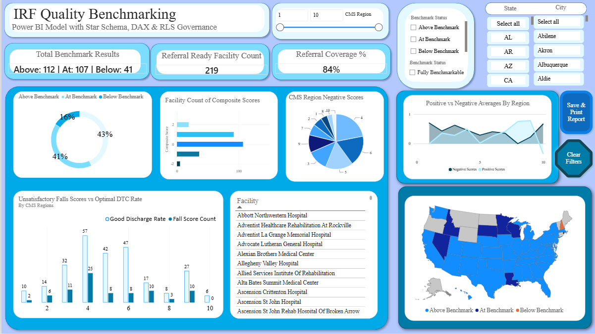
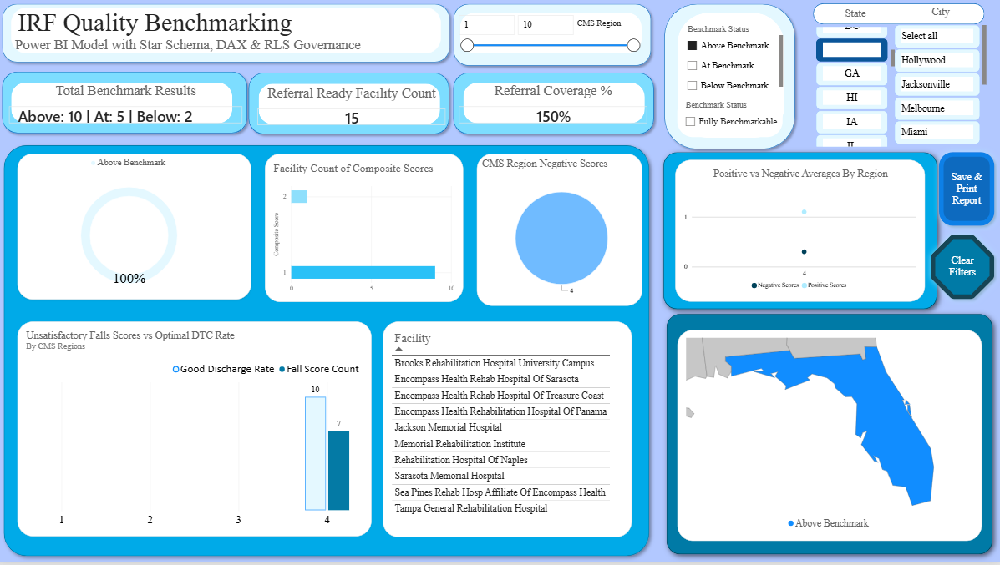
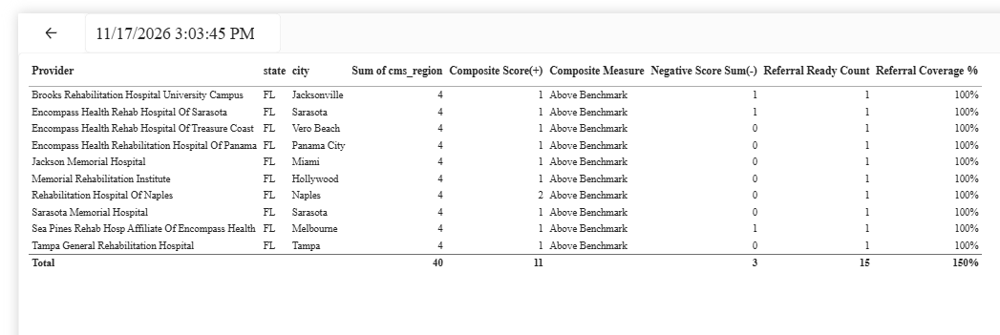
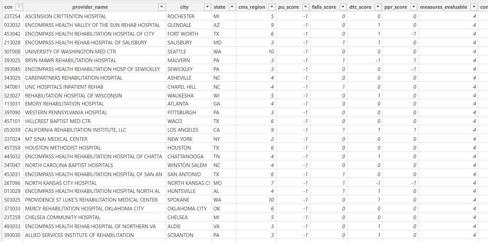

# IRF Quality Benchmarking (P3 Power BI)

## Business Problem
A national referral network needs to decide which inpatient rehabilitation facilities (IRFs) to include in its referral network. Three obstacles block that decision:

CMS quality data spans four incomparable measures (pressure ulcer SIR, falls SIR, discharge-to-community rate, potentially preventable readmission rate) on different scales and directions.

78.7% of facilities (962 of 1,222) are suppressed on at least one measure, so most facilities cannot be fully benchmarked.

Analysis is done in manual spreadsheets with no governed refresh, no audit trail, and no way to trace a recommendation back to its source data.

## The solution
* The network is looking for an auditable transparent referral tool that will provide the following:
Restricts rankings to fully measured facilities (4/4 measures), so every recommendation is supported with complete data, clean readable data with the measurable facilities including what the composite scores mean and which facilities are above the composite scores.
Allows users to be able to have a detailed view of filterable results from scores, rankings, benchmark status, states and viewable facility measures from results.   
* Produces a reportable audit document for governance and leadership review

The result from the dashboard and the report will provide a governed BI solution that answers the **business question**: *which facilities are safe to steer referrals to, and how much does data suppression limit that answer?*

*Below I have an example of a filtered Dashboard and Reports page using FL, above the benchmark selected to view final results to target the core question*

## Tools Utilized
* Power BI Desktop 
* GitHub: [Link to Full Project]("https://github.com/sakurakonami/IRF-Quality-Benchmarking-P3-Power-BI-.git")
* Microsoft Visual Studio Code
* Power Query 
* DAX & DAX query view
* Power BI Service
* [Google Doc]("https://docs.google.com/document/d/e/2PACX-1vRAlwpR0QprkGuKsh9RJUsiXrFBdFiAORjgvfUYAy8VJ6hrjoETRbjo-GgbaEazrPv8QcR4tRLYIEDo/pub")
* Data pulled from my first two Projects: **Part 1** SQL/ Postgres: [Hospital Rehab Analysis]("https://github.com/sakurakonami/Hospital-Rehab-Analysis.git")  **Part 2** Excel:  [IRF-Quality-Benchmarking]("https://github.com/sakurakonami/IRF-Quality-Benchmarking.git")

*Paper prototype of dashboard*
## Data Preparation
* Imported the CMS IRF Excel extract into Power BI.
Removed null values, "NULL" text strings, "Not Available" entries, and blank rows.

* Converted text fields to correct data types: whole numbers for scores and counts, decimals for SIRs and rates, text for identifiers.

* Categorized geography fields (city, state, CMS region) and set data categories so maps render correctly.

* Built relationships in Model view on matching keys (ccn, state, city, cms_region).

* Ranking rule: restricted all analysis to facilities with measures_evaluable = 4 — fully measured, 4/4 — so every recommendation is supported by complete data.

## Measure and Column Design (DAX)
Created column Composite Measures translating the composite score into readable categories: Above Benchmark, At Benchmark, Below Benchmark.

Created a calculated column Negative Score Count counting how many of the four measures are worse than benchmark (-1).

Created three count measures — facilities above, at, and below benchmark — validated in DAX query view.

Created a referral-ready count measure (fully measured and above benchmark).

Created a referral coverage % measure (referral-ready ÷ total facilities).

Validated the eligibility rule with a mismatch check: measures_evaluable = 4 vs. benchmark_status = "Fully benchmarkable" returned 0 mismatches across 1,222 facilities.

## Dashboard Design

**KPI cards**

* Facilities above / at / below benchmark
* Referral-ready facility count
* Referral coverage % of the full network

**Slicers (user-controlled, all default to "All")**
* State
* CMS region
* City
* Benchmark status
* Composite score outcome

**Visuals**
* Donut chart — benchmark status mix across all facilities (fully benchmarkable vs. partial/suppressed).
* Column chart — distribution of facilities by composite score; roughly 110 sit exactly at benchmark (0).
* Pie chart — negative outcome share by CMS region; Region 6 shows the highest share of negative falls, infection, and readmission scores, Region 1 the lowest.
* Filled map — states colored by benchmark position (above, at, below), with facility counts.
* Line chart — average positive vs. negative outcomes by CMS region.
* Bar chart — good vs. bad score counts by region.
* Facility table — full facility list with benchmark score, composite score, location, and referral coverage; fully interactive with all slicers.

*Every visual responds to the same slicer panels, so users can filter once and see every chart update together.*

## Audit Report
* Created a dedicated "Reports" page designed as a clean, vertical document rather than a dashboard.

Table includes: provider name, state, city, composite score, composite meaning, negative score count, referral-ready count, CMS region, referral coverage %, and a current timestamp.

Added a "Save & Print Report" action button on the main dashboard that navigates to the Reports page via bookmark, carrying the user's active slicer selections.

Added a back arrow for easy return to the dashboard.

Added a "Clear Filters" button (hover turns red) so users can reset all slicers in one click instead of unchecking each one — cutting roughly two minutes off each session.

**Worked example:** A network provider in Florida wants fully benchmarkable, above-benchmark, referral-ready facilities. They select Above Benchmark, FL, and Fully benchmarkable in the slicers, click Save & Print Report, and land on a filtered Reports page showing exactly those facilities with scores, map location, and referral coverage — ready to print or save as PDF via Ctrl+P.

## Final Conclusion

**This project delivers a governed, auditable referral tool that answers the network's core question.** Of 1,222 facilities, only 219 are fully measured and at or above benchmark meeting the referral coverage, and the dashboard makes that limitation visible rather than hiding it. Users can filter by state, region, city, benchmark status, and composite outcome, then view facilities on a map, in ranked tables, and in KPI cards that update together. The printable audit page lets leadership save and share a filtered, traceable record of any referral decision.
The project demonstrates that quality data can be turned into a trustworthy referral workflow — but only when suppression is treated as a first-class finding, not an inconvenience. The 78.7% suppression rate is not a footnote; it is the central constraint on how many facilities the network can confidently recommend, and the dashboard surfaces it alongside every recommendation.

## Skills Gained and Demonstrated
**Technical**

* Star-schema data modeling and relationship design
* DAX calculated columns and measures (CALCULATE, COUNTROWS, SWITCH, ISBLANK, DIVIDE)
*Data cleaning: null handling, text-to-number conversion, sentinel values
* Interactive dashboard design with slicers, bookmarks, and action buttons
* Filter propagation across pages via sync slicers
* Measure validation using DAX query view
* Data modeling, Report design, Eligibility rule validation, Suppression as a KPI, Audit page, Filter preservation, Documented limitations,
* Source data handling: reviewed column structure, identified text-encoded nulls, mapped columns to the Power BI model, and documented the source-to-model lineage.

**Healthcare domain**

* CMS IRF quality measures: SIR, risk-standardized rates, observed rates
* Benchmark status interpretation (better / worse / no different / not available)
* Suppression as a data-quality and decision-quality constraint
* Referral-network decision support
* Analytical judgment
* Restricted rankings to fully measured facilities so every recommendation is defensible
* Validated the eligibility rule (0 mismatches) before building on it
* Treated suppression as a headline KPI rather than hiding it

* Documented limitations (no payment data, no reporting period, mixed-scale composite)

**Communication and design**

* Executive-ready KPI layout
* Consistent semantic color coding

* Plain-language explanation of the composite score
* Printable audit page for governance review